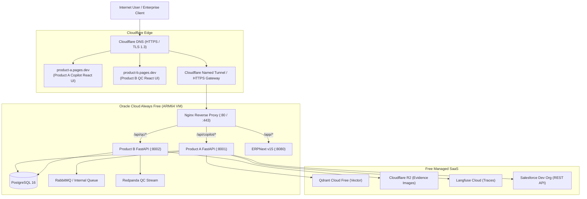

# FREE-TIER ZERO-COST CLOUD DEPLOYMENT SPECIFICATION

This document details the exact configuration, architecture, and deployment procedures for running **Product A** and **Product B** on 100% free cloud infrastructure without incurring charges.

---

## 1. Verified Free-Tier Platform Inventory

| Layer | Platform | Free Allocation / Limits | SLA & Eviction Policies | Role in Enterprise AI Suite |
| :--- | :--- | :--- | :--- | :--- |
| **Frontends** | **Cloudflare Pages** | Unlimited bandwidth, 500 builds/mo, free `*.pages.dev` + custom domains + automatic SSL/TLS | Zero cold start, high availability global CDN edge | Hosts React Web Apps for Product A & Product B |
| **Compute & ERP** | **Oracle Cloud Always Free (A1 ARM64)** | **2 OCPU, 12 GB RAM**, 200 GB Block Storage (Note: reduced from 4 OCPU / 24 GB in 2026) | Reclaims instances if CPU < 15% for 7 days (mitigated with active workload) | Hosts ERPNext, FastAPI services, Nginx reverse proxy |
| **Vector DB** | **Qdrant Cloud Free** | 1 cluster, 1 GB RAM, 0.5 vCPU, 4 GB Disk | Inactivity pause after 7 days without queries (auto-resumed via health check) | Hybrid document retrieval (Dense + Sparse) for Copilot |
| **Object Storage** | **Cloudflare R2** | 10 GB-months storage, 1M Class A operations, 10M Class B operations, **$0 egress fees** | Persistent, S3 API compatible | QC image uploads, defect crops, audit evidence |
| **LLM Tracing** | **Langfuse Cloud Hobby** | 50,000 observations/month, 30-day retention | Free tier, rate-limited if exceeded | Complete trace spans, token attribution, latency monitor |
| **CRM Sandbox** | **Salesforce Developer Edition** | 5 MB data storage, 20 MB file storage, full REST/SOAP API access, OAuth 2.0 | Does not expire as long as logged in periodically | Live Salesforce Account & Opportunity sync adapter |
| **In-Memory Cache** | **Local Redis / Upstash Free** | Local: RAM bounded to 256MB on VM. Upstash: 256MB, 500k commands/day | Redis local on Docker VM network | Session checkpointer, token rate limits, query cache |
| **CI/CD & Evals** | **GitHub Actions** | 2,000 Linux build minutes/month | Ephemeral runners | Multi-arch Docker builds, unit tests, DeepEval runs |

---

## 2. Resource Sizing & Memory Allocation Budget (Oracle A1: 12 GB RAM)

To guarantee that ERPNext, FastAPI backends, and local streaming components remain stable without triggering the Linux Out-Of-Memory (OOM) killer, memory limits are hard-coded in Docker Compose:

```
Total Physical Memory: 12,288 MB (12 GB)
Reserved for Linux OS & Kernel Buffers: 1,536 MB (1.5 GB)
Available for Containerized Workloads: 10,752 MB (10.5 GB)

Service Allocation (Profile 2: Demo):
├── ERPNext + MariaDB + Redis Cache + Workers: 5,120 MB (5.0 GB)
│   ├── ERPNext Web & Socketio: 1,536 MB
│   ├── MariaDB 10.6 (innodb_buffer_pool_size=1G): 1,536 MB
│   ├── ERPNext Background Worker (default/short/long): 1,536 MB
│   └── Redis (Queue + Cache): 512 MB
├── Product A Backend (FastAPI + LangGraph + Hybrid RAG): 1,280 MB (1.25 GB)
├── Product B Backend (FastAPI + ONNX Runtime CPU Inference): 1,536 MB (1.5 GB)
├── PostgreSQL 16 (Application Metadata + QC Inspection state): 1,024 MB (1.0 GB)
├── Message Bus (Redpanda Single-Node or Light Queue): 1,024 MB (1.0 GB)
├── Nginx Reverse Proxy + SSL Termination: 256 MB (0.25 GB)
└── Safety Headroom / Buffer: 512 MB (0.5 GB)
```

---

## 3. Public Network Architecture & Domain Routing



---

## 4. Step-by-Step Provisioning Guide

### Step 1: Frontend Deployment on Cloudflare Pages
1. Fork or push repository to GitHub.
2. In Cloudflare Dashboard -> **Workers & Pages** -> **Create application** -> **Pages** -> **Connect to Git**.
3. Select repository:
   - For Product A: Root directory: `product-a-copilot/frontend`, Build command: `npm run build`, Output: `dist`.
   - For Product B: Root directory: `product-b-qc/frontend`, Build command: `npm run build`, Output: `dist`.
4. Configure Environment Variables:
   - `VITE_API_BASE_URL`: `https://api.yourdomain.com/api/copilot`
   - `VITE_QC_API_BASE_URL`: `https://api.yourdomain.com/api/qc`

### Step 2: Oracle Cloud VM Provisioning (ARM64 Ampere A1)
1. Sign in to Oracle Cloud Free Tier.
2. Go to **Compute** -> **Instances** -> **Create Instance**:
   - Image: **Ubuntu 24.04 LTS (AArch64)**
   - Shape: **Ampere VM.Standard.A1.Flex**
   - OCPU count: **2 OCPU**
   - Memory: **12 GB RAM**
   - Boot Volume: **100 GB**
3. In Virtual Cloud Network (VCN) Ingress Rules, allow TCP ports:
   - `22` (SSH)
   - `80` (HTTP)
   - `443` (HTTPS)
   *(Database ports 5432, 3306, 6379, 9092, 5672 remain completely private)*.

### Step 3: Cloudflare R2 Bucket Setup
1. Cloudflare Dashboard -> **R2** -> **Create bucket**: `enterprise-qc-evidence`.
2. Generate S3 API Token: Permissions `Object Read & Write`.
3. Save Access Key ID, Secret Access Key, and Endpoint URL.

### Step 4: Qdrant Cloud Free Cluster Setup
1. Register at [cloud.qdrant.io](https://cloud.qdrant.io).
2. Create Free Tier cluster (1GB RAM).
3. Generate API Key and copy Endpoint URL (`https://xyz.qdrant.io:6333`).

### Step 5: Langfuse Cloud Setup
1. Register at [cloud.langfuse.com](https://cloud.langfuse.com) (Hobby plan).
2. Create Project: `enterprise-ai-suite`.
3. Copy Public Key, Secret Key, and Host (`https://cloud.langfuse.com`).
