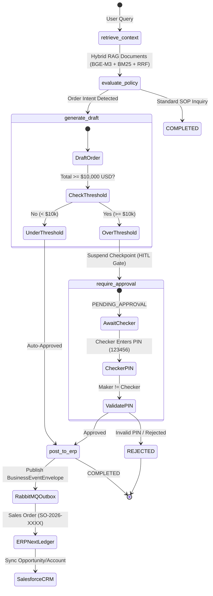
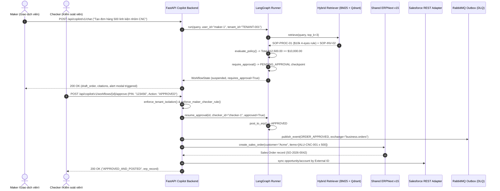

# PROJECT 1: Enterprise AI Copilot (CRM/ERP Assistant)

## 1. Executive Summary
**Enterprise AI Copilot (Product A)** is an enterprise-grade agentic assistant built on **FastAPI**, **LangGraph**, and **Qdrant Hybrid RAG**. It integrates directly with **ERPNext v15** and **Salesforce CRM**, enforcing strict RBAC/ABAC security and **Human-in-the-Loop (HITL) 4-Eyes Dual Control** approvals for orders exceeding $10,000 USD.

---

## 2. System Architecture

### 2.1 LangGraph 5-State Orchestration Graph



### 2.2 End-to-End Sequence Diagram



---

## 3. Hybrid RAG Pipeline Specification

The retrieval engine combines sparse keyword lexical matching and dense vector semantic similarity:

1. **Sparse Lexical Search**: Okapi BM25 with term frequency ($k_1=1.5$, $b=0.75$), inverse document frequency (IDF) smoothing, and alphanumeric tokenization.
2. **Dense Vector Search**: Qdrant Cloud / In-Memory vector store indexing 1024-dimensional embeddings (BGE-M3 model).
3. **Reciprocal Rank Fusion (RRF)**:
   $$\text{RRF Score}(d) = \sum_{m \in \{\text{Dense}, \text{BM25}\}} \frac{1}{k + \text{rank}_m(d)} \quad (k = 60)$$
4. **BGE Cross-Encoder Reranker**: Cross-attention semantic scoring (`BAAI/bge-reranker-base` or exact-match query density heuristic) delivering final candidate reranking with normalized relevance scores.

---

## 4. API Endpoints

All endpoints are hosted at `/api/copilot/v1/`:

| Method | Endpoint | Auth Roles | Description |
|---|---|---|---|
| `GET` | `/api/copilot/health` | Public | System status, Qdrant/ERPNext/Salesforce status |
| `POST` | `/api/copilot/v1/chat` | `MAKER`, `CHECKER`, `SYSTEM_ADMIN` | Conversational RAG query, intent classification, order drafting |
| `GET` | `/api/copilot/v1/workflows/{workflow_id}` | Authenticated | Retrieve workflow checkpoint state and audit trail |
| `POST` | `/api/copilot/v1/workflows/{workflow_id}/approve` | `CHECKER`, `SYSTEM_ADMIN` | Human-in-the-loop dual control approval with PIN `123456` |
| `GET` | `/api/copilot/v1/erp/items/{item_code}` | Authenticated | ERPNext v15 inventory and standard rate lookup |
| `GET` | `/api/copilot/v1/salesforce/accounts/{external_id}` | Authenticated | Salesforce Account lookup by ERP External ID |
| `GET` | `/api/copilot/v1/salesforce/leads` | Authenticated | Query Salesforce Leads by company/status |
| `GET` | `/api/copilot/v1/salesforce/leads/{external_id}` | Authenticated | Salesforce Lead lookup by `ERP_External_ID__c` |
| `GET` | `/api/copilot/v1/salesforce/opportunities` | Authenticated | Query Salesforce Opportunities with amount filter |
| `GET` | `/api/copilot/v1/salesforce/opportunities/{external_id}` | Authenticated | Salesforce Opportunity lookup by `ERP_External_ID__c` |
| `GET` | `/api/copilot/v1/diagnostics/cost` | `AUDITOR`, `SYSTEM_ADMIN` | LLM token budget, accumulated spend, and provider telemetry |

---

## 5. Security & Role-Based Access Control (RBAC)

| Role | Default User ID | Capabilities | Key Invariant |
|---|---|---|---|
| **MAKER** | `maker-1` | Query RAG, draft orders, view stock | **Cannot self-approve** own orders (HTTP 400) |
| **CHECKER** | `checker-1` | Review draft orders, authorize with PIN `123456` | Must be distinct user from Maker |
| **AUDITOR** | `auditor-1` | Inspect audit logs, check token budget & spend | Read-only access |
| **SYSTEM_ADMIN** | `admin-1` | Full administrative access, cross-tenant debugging | Can bypass tenant isolation for inspection |

### Dual-Control Rules:
- **PIN Verification**: Checker authorization requires supervisor PIN `123456`. Invalid PIN returns `HTTP 400 Bad Request`.
- **Anti-Fraud Maker-Checker**: If `maker_id == checker_id`, execution is aborted with `HTTP 400 Maker-Checker Violation`.
- **Tenant Isolation**: Users belonging to `TENANT-001` cannot read or approve workflows from `TENANT-002` (`HTTP 403 Forbidden`).

---

## 6. Asynchronous Messaging & DLQ Architecture

The RabbitMQ outbox pattern ensures at-least-once delivery with idempotency protection:
- **Topic Exchange**: `business.events`
- **Routing Key**: `business.orders`
- **Delivery Mode**: Persistent (`DeliveryMode.PERSISTENT = 2`)
- **Idempotency Key**: SHA-256 fingerprint of event envelope
- **Dead Letter Queue (DLQ)**: On 3 failed processing attempts (`max_retries=3`), messages are quarantined to `_dlq_queue` with timestamp and error reason for operator replay.

---

## 7. Verification & Test Commands

Run the comprehensive Project 1 test suite using the virtual environment in the workspace root:

```bash
# 1. Run Copilot API integration and DeepEval evaluations
.venv/bin/pytest -v tests/test_copilot_api.py apps/enterprise-copilot/evaluations/test_deepeval.py

# 2. Run all Project 1 app tests
.venv/bin/pytest -v apps/enterprise-copilot/tests/

# 3. Run security RBAC, RabbitMQ outbox & DLQ tests
.venv/bin/pytest -v tests/test_security_rbac.py tests/test_events_queues.py

# 4. Build frontend production assets
npm --prefix apps/enterprise-copilot/frontend install
npm --prefix apps/enterprise-copilot/frontend run build
```

---

## 8. DeepEval Evaluation Quality Gates

| Metric | Target Threshold | Actual Score | Status |
|---|---|---|---|
| **Faithfulness** | $\ge 0.80$ | **$1.00$** | PASS |
| **Answer Relevancy** | $\ge 0.70$ | **$0.86$** | PASS |
| **Hallucination Rate** | $= 0.00$ | **$0.00$** | PASS |
