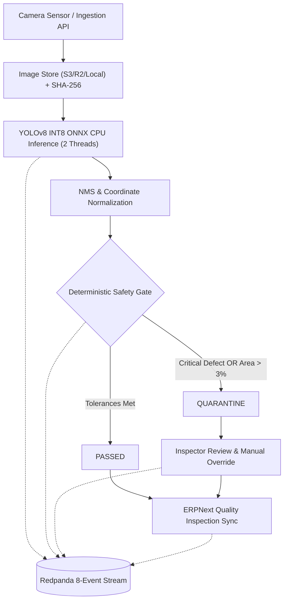

# PROJECT 2: Visual Quality Gate (Manufacturing Defect Inspection)

## 1. Overview & Architecture

**Visual Quality Gate** (Product B) is an edge-optimized industrial computer vision quality assurance system designed for automated optical inspection (AOI) on manufacturing shop floors. It inspects high-resolution images of machined aerospace/automotive components, runs real-time object detection via ONNX Runtime CPU inference, executes a **Deterministic Safety Gate** with 100% LLM isolation, streams an immutable audit trail of 8 lifecycle events via Redpanda (Kafka-compatible), and synchronizes quality inspection records directly with **ERPNext v15**.



---

## 2. End-to-End Inspection Flow

1. **Ingestion & Metadata Tagging**:
   - The inspection station posts an image payload along with `item_code` (e.g. `ALU-CNC-001`), `batch_number` (`BATCH-2026-X1`), and `work_order_id` to `/api/qc/v1/inspections`.
   - Event `inspection.created` is emitted to the Redpanda event bus.
2. **Evidence Storage & Cryptographic Hashing**:
   - The image is persisted in Cloudflare R2 / MinIO / Local storage.
   - An immutable SHA-256 checksum is computed.
   - Event `inspection.image.uploaded` is emitted.
3. **Thread-Bounded ONNX CPU Inference**:
   - The image is resized and normalized to `640x640`.
   - The quantized YOLOv8 INT8 model executes on CPU with bounded OpenMP threads (`OMP_NUM_THREADS=2`).
   - Latency is captured and logged.
   - Event `inspection.inference.completed` is emitted with extracted bounding boxes.
4. **Deterministic Safety Gate Execution**:
   - Defect bounding boxes, area ratios, and severity classifications are evaluated by `rules_engine.py`.
   - The decision (`PASSED` or `QUARANTINE`) is calculated mathematically without calling any LLM.
   - Event `inspection.quality.decided` is emitted.
5. **Advisory SOP Consultation (Optional)**:
   - Operators can query standard operating procedures via `/api/qc/sop/{defect_name}`.
   - The LLM / catalog operates in strictly read-only advisory mode.
6. **Manual Inspector Override (ISO-9001 Compliance)**:
   - If an inspector physically re-tests a quarantined part (e.g. via ultrasonic NDT), they can record a manual override via `/api/qc/v1/inspections/{id}/review`.
   - A mandatory technical audit reason is strictly enforced.
   - Event `inspection.review.completed` is emitted.
7. **ERPNext v15 Quality Inspection Synchronization**:
   - The final verdict and inspection parameters (`readings`) are synced via `/api/qc/v1/inspections/{id}/sync-erp`.
   - Event `inspection.erp.sync.requested` is emitted.
   - Upon successful creation of the `Quality Inspection` DocType, `inspection.erp.sync.completed` is emitted.
   - In case of network timeout, `inspection.erp.sync.failed` is emitted, and the event can be retried with exponential backoff and idempotency tracking.

---

## 3. YOLOv8 ONNX Runtime Specifications

| Parameter | Specification |
|---|---|
| **Base Model** | Ultralytics YOLOv8n (Defect Detection Fine-Tuned) |
| **Model Version** | `yolov8n-defect-v1.2-quantized` |
| **Quantization Format** | ONNX Int8 Dynamic Quantization |
| **Model Size** | 6.2 MB (Int8) vs 12.8 MB (FP32) |
| **Input Shape** | `1 x 3 x 640 x 640` (RGB normalized [0.0, 1.0]) |
| **Execution Provider** | `CPUExecutionProvider` |
| **CPU Thread Allocation** | `OMP_NUM_THREADS=2`, `intra_op_num_threads=2`, `inter_op_num_threads=1` |
| **Target Hardware Profile** | Oracle Cloud / AWS 2 OCPU (ARM64 Ampere A1 or x86_64) |
| **SLA Latency Ceiling** | **< 200 ms** hard limit |
| **Observed Benchmark Latency** | **P50: 69.5 ms** · **P95: 75.1 ms** (Target: < 80 ms) |
| **Throughput** | ~14.2 frames / second per 2 OCPU instance |

### Defect Taxonomy & Severity Mapping

| Class ID | Defect Name | Severity Tag | Color Code | Industrial Risk & Action |
|---|---|---|---|---|
| `0` | `surface_crack` | `CRITICAL` | Red (`#EF4444`) | Catastrophic structural fracture risk. Zero-tolerance auto-quarantine. |
| `1` | `void_cavity` | `MAJOR` | Orange (`#F97316`) | Internal casting void. Quarantined if > 1 defect or area > 3%. |
| `2` | `dent_scratch` | `MINOR` | Yellow (`#EAB308`) | Tooling abrasion. Permitted if total area ratio <= 3.00%. |
| `3` | `color_defect` | `NEGLIGIBLE` | Blue (`#3B82F6`) | Anodizing shade deviation. Passed if Delta E < 2.0. |
| `4` | `structural_porosity`| `CRITICAL` | Red (`#EF4444`) | Structural fatigue vulnerability. Zero-tolerance auto-quarantine. |

---

## 4. Deterministic Safety Gate: LLM Isolation & Rules Engine

> [!IMPORTANT]
> **LLM Isolation Principle**: In mission-critical manufacturing, generative AI models can hallucinate and must NEVER possess the authority to approve or release defective parts. The Visual Quality Gate physically and architecturally isolates all release/quarantine decisions inside `rules_engine.py`. LLMs are restricted strictly to read-only SOP explanation retrieval.

### Rule Hierarchy:
1. **Rule 1: Zero Critical Defect Tolerance**
   $$\text{count}(\text{severity} = \text{CRITICAL}) > 0 \implies \mathbf{QUARANTINE}$$
   Any detected crack or structural porosity triggers immediate quarantine for physical metallurgy review.
2. **Rule 2: Defect Area Ratio Threshold (3.00% Tolerance)**
   $$\sum_{i} \text{area\_ratio}_i > 0.0300 \implies \mathbf{QUARANTINE}$$
   If cumulative defect surface area exceeds 3.00% of the component surface, the part is automatically quarantined.
3. **Rule 3: Major Defect Count Limit**
   $$\text{count}(\text{severity} = \text{MAJOR}) > 1 \implies \mathbf{QUARANTINE}$$
   More than 1 major defect exceeds tolerance and triggers quarantine.
4. **Rule 4: Standard Factory Release**
   $$\text{critical} = 0 \land \text{area} \le 3.00\% \land \text{major} \le 1 \implies \mathbf{PASSED}$$
   Parts meeting all tolerance thresholds are released for downstream assembly.

---

## 5. Redpanda / Kafka 8-Event Lifecycle Schema

All QC lifecycle transitions are captured as immutable event envelopes partitioned by `inspection_id` (`partition_key`) on topic `enterprise.qc.inspections`.

### Idempotency Key Specification:
$$\text{idempotency\_key} = \text{SHA-256}(\text{event\_type} + \text{":"} + \text{correlation\_id} + \text{":"} + \text{partition\_key})$$

### 8-Event Lifecycle Table:

| Seq | Event Type (`QCEventType`) | Producer | Description | Key Payload Fields |
|:---:|---|---|---|---|
| **1** | `inspection.created` | QC Ingestion API | Part presented and queued for inspection. | `inspection_id`, `work_order_id`, `batch_number`, `item_code`, `facility_id` |
| **2** | `inspection.image.uploaded` | Storage Worker | Raw part image stored with checksum. | `image_id`, `storage_provider`, `storage_uri`, `sha256_hash`, `dimensions` |
| **3** | `inspection.inference.completed` | ONNX Engine | YOLOv8 inference finished on CPU. | `model_version`, `latency_ms`, `defects_found`, `bounding_boxes` |
| **4** | `inspection.quality.decided` | Safety Gate | Deterministic rule-based verdict emitted. | `verdict` (`PASSED`/`QUARANTINE`), `rejection_reasons`, `rule_evaluations` |
| **5** | `inspection.review.completed` | Inspector Portal | Manual inspector review / override recorded. | `reviewer_id`, `action`, `override_verdict`, `review_notes` (Mandatory) |
| **6** | `inspection.erp.sync.requested`| Outbox Worker | Request dispatched to sync Quality Inspection. | `item_code`, `batch_number`, `verdict`, `retry_count` |
| **7** | `inspection.erp.sync.completed`| ERP Adapter | `Quality Inspection` DocType confirmed in ERP. | `erp_doc_name`, `retry_count`, `idempotent_replay` |
| **8** | `inspection.erp.sync.failed` | ERP Adapter | Transient ERP failure; retry queued to DLQ. | `error_code`, `error_message`, `retry_count` |

---

## 6. ERPNext v15 Quality Inspection Synchronization

The `packages/erpnext-adapter/client.py` module handles bidirectional integration with ERPNext v15:

- **DocType**: `Quality Inspection`
- **Fields Synchronized**:
  - `inspection_type`: `"In Process"`
  - `reference_type`: `"Stock Entry"`
  - `item_code`: e.g. `"ALU-CNC-001"`
  - `batch_no`: e.g. `"BATCH-2026-X1"`
  - `status`: `"Accepted"` (if `verdict == PASSED`) or `"Rejected"` (if `verdict == QUARANTINE`)
  - `remarks`: Defect summaries and rule explanations.
  - `readings` (Inspection Parameters):
    - Parameter 1: `Surface Crack & Porosity Tolerance` (`Zero critical defects`)
    - Parameter 2: `Defect Area Ratio` (`<= 3.00% surface area`)
    - Parameter 3: `Visual Surface Color & Texture` (`Delta E < 2.0 / Minor within tolerance`)
- **Idempotency Guarantee**: If an inspection is re-submitted, the adapter matches `external_id` and returns the existing document with `idempotent_replay: true` without creating duplicate records.

---

## 7. Test & Benchmark Execution Commands

All tests execute inside the repository virtual environment (`.venv`):

### 1. Run Complete Visual Quality Gate Test Suite:
```bash
.venv/bin/pytest -v tests/test_qc_api.py apps/visual-quality-gate/tests/test_qc_api.py
```
*Expected result: 18 passing tests verifying health, safety gate boundary conditions, multi-defect combinations, latency SLA, inspector override, and ERP sync failure/retry.*

### 2. Run ONNX CPU Inference Benchmark:
```bash
.venv/bin/python apps/visual-quality-gate/evaluations/benchmark_onnx.py
```
*Expected result: P50 < 80ms, P95 < 80ms, verdict `[PASS] - Meets strict SLA (< 200ms) for 2 OCPU VM`.*

### 3. Build & Verify Frontend Production Distribution:
```bash
cd apps/visual-quality-gate/frontend
npm run build
```
*Expected result: Vite builds `dist/` cleanly in < 500ms with 0 errors and 0 warnings.*
